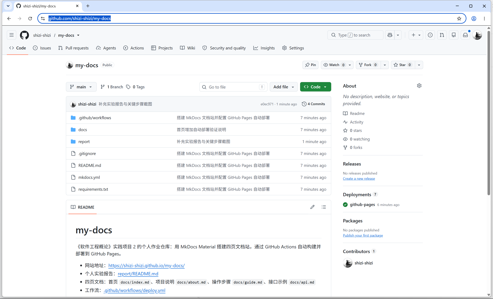
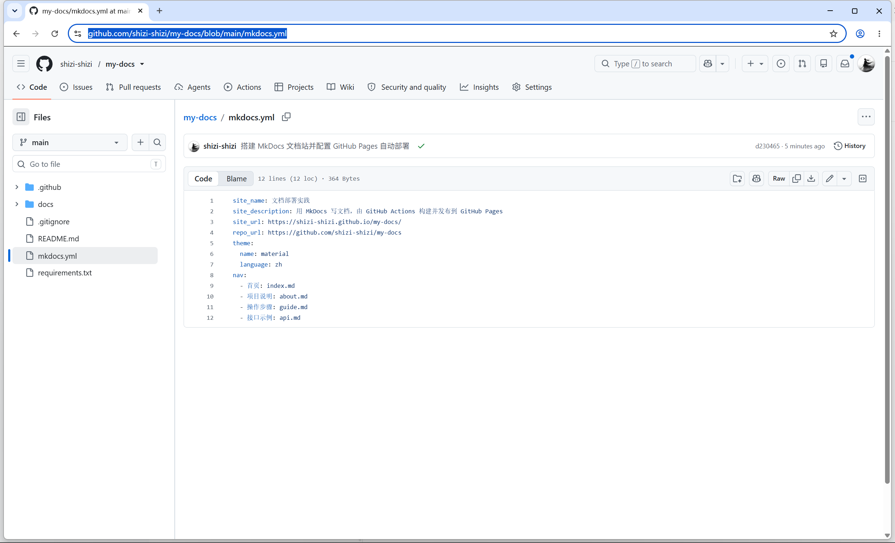
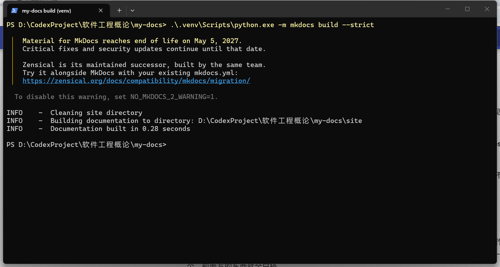
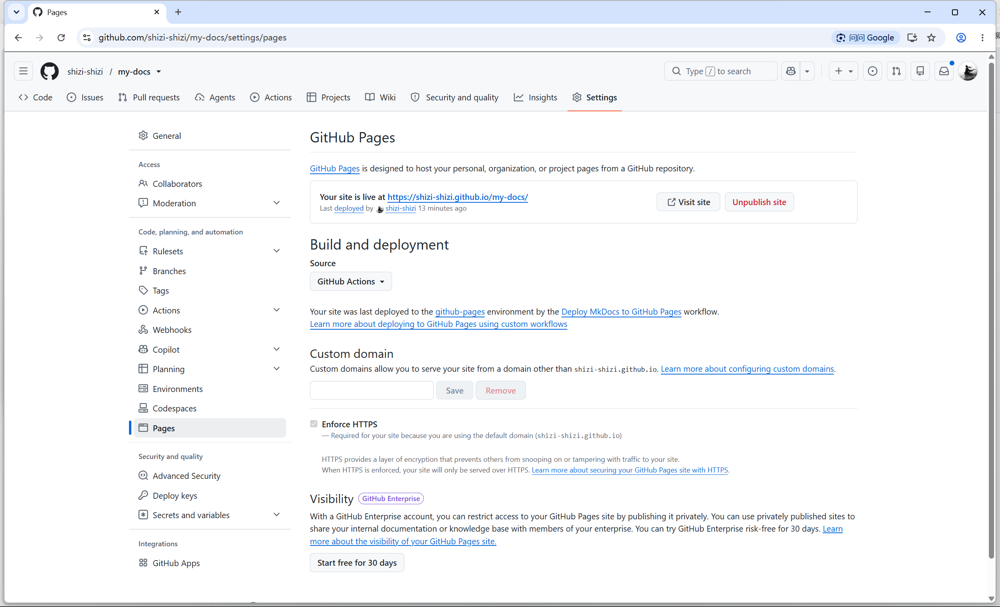
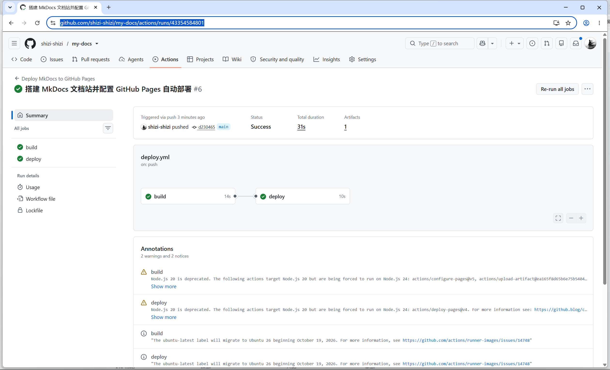
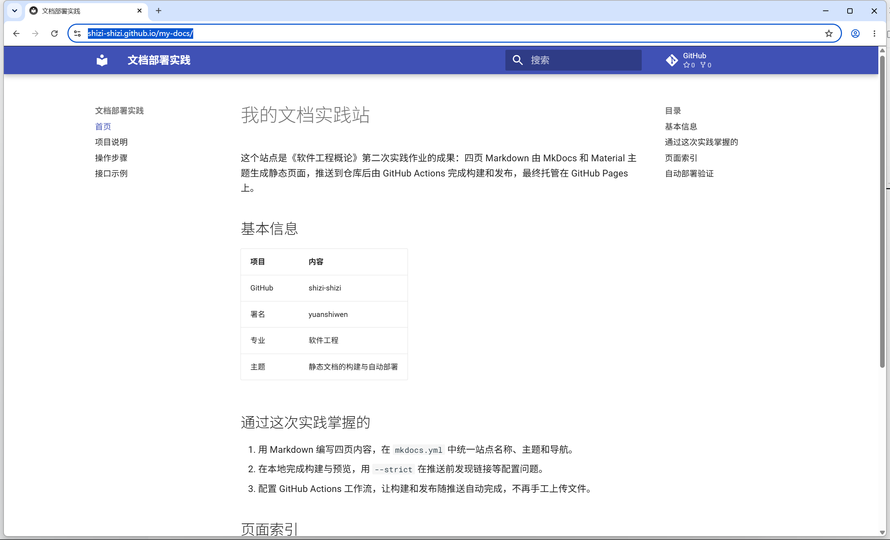
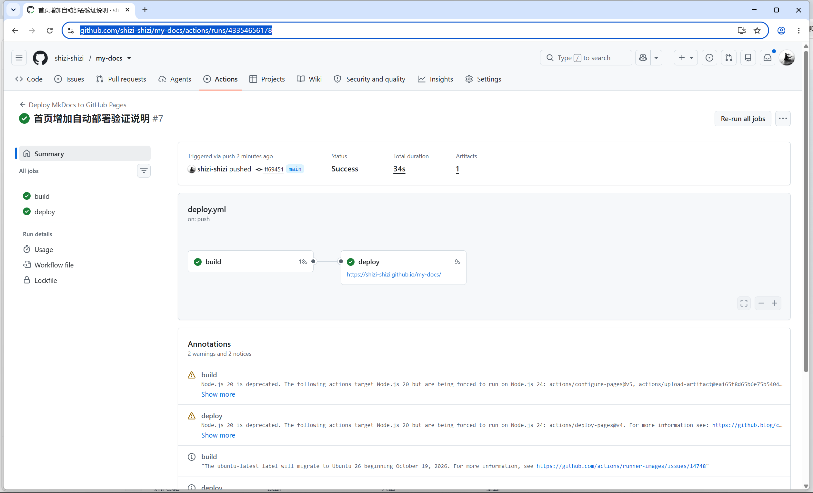
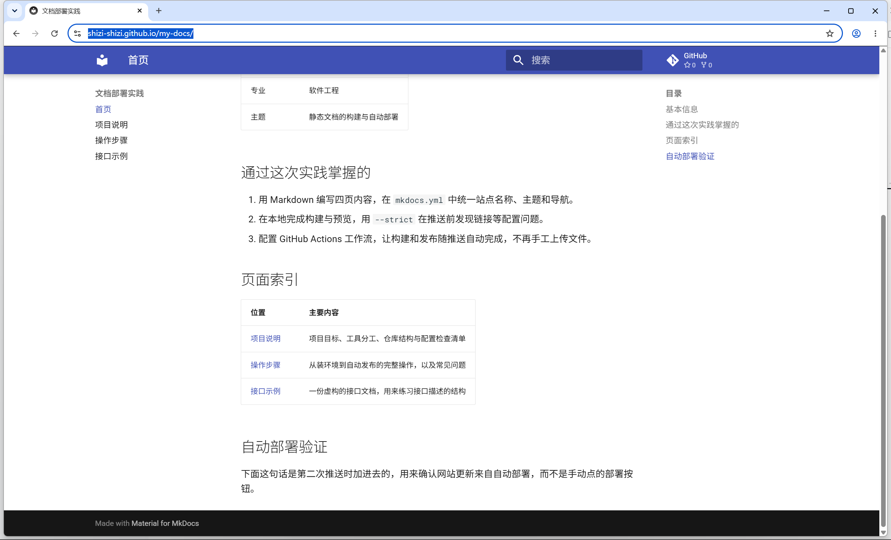

# 实践项目2：个人实验报告

## 1. 基本信息

- GitHub 登录名：shizi-shizi
- 姓名拼音：yuanshiwen
- 个人仓库：<https://github.com/shizi-shizi/my-docs>
- 网站地址：<https://shizi-shizi.github.io/my-docs/>
- 首次部署运行：<https://github.com/shizi-shizi/my-docs/actions/runs/43354584801>
- 第二次部署（自动更新验证）：<https://github.com/shizi-shizi/my-docs/actions/runs/43354656178>

## 2. 实践过程与关键截图

### 2.1 仓库创建

创建公开仓库 `my-docs`，Owner 为本账号，默认分支 `main`，克隆到本地



### 2.2 项目结构与 MkDocs 配置

目录结构：

```text
my-docs/
├── .github/workflows/deploy.yml
├── docs/
│   ├── index.md
│   ├── about.md
│   ├── guide.md
│   └── api.md
├── report/
│   ├── README.md
│   └── images/
├── mkdocs.yml
├── requirements.txt
├── .gitignore
└── README.md
```

`mkdocs.yml`：

```yaml
site_name: 文档部署实践
site_url: https://shizi-shizi.github.io/my-docs/
repo_url: https://github.com/shizi-shizi/my-docs
theme:
  name: material
  language: zh
nav:
  - 首页: index.md
  - 项目说明: about.md
  - 操作步骤: guide.md
  - 接口示例: api.md
```

- `docs/`：文档源文件，需要手写内容的地方。
- `site/`：构建产物，由 `docs/` 生成，每次构建重新创建，已写入 `.gitignore`，不提交到仓库。
- `nav`：导航配置，路径相对于 `docs/`，因此写 `index.md` 而不是 `docs/index.md`。
- `report/`：实践报告与截图，不在工作流的 `paths` 中，修改后不会触发部署。



### 2.3 本地构建

```bash
python -m venv .venv
.\.venv\Scripts\python.exe -m pip install -r requirements.txt
.\.venv\Scripts\python.exe -m mkdocs build --strict
```

`--strict` 把警告视为错误，链接写错时构建直接失败，可在推送前发现问题。

结果：构建通过，输出 `Documentation built in 0.28 seconds`，无警告。本地预览打开四页，导航、表格、代码块显示正常。



### 2.4 Pages 设置

- 操作：Settings → Pages → Build and deployment，将 Source 从 `Deploy from a branch` 改为 **GitHub Actions**。
- 说明：本方案由工作流将 `site/` 上传为构建产物，再由 Pages 发布，产物不经过任何分支，因此不需要 `gh-pages` 分支，也不需要创建和审批 PR 的权限。
- 结果：Source 保存为 GitHub Actions，页面显示网站已发布地址。



### 2.5 Actions 首次构建和部署

工作流 `.github/workflows/deploy.yml` 包含两个任务：

- `build`：检出源码、安装 Python 3.12、配置 Pages、安装依赖、`mkdocs build --strict`、将 `site/` 上传为构建产物。
- `deploy`：依赖 `build`，使用 `pages: write` 与 `id-token: write` 权限发布到 `github-pages` 环境。

两个任务分开，便于按需分配权限，构建失败时也不会影响线上网站。

结果：`build` 用时 14 秒，`deploy` 用时 10 秒，整次运行 31 秒成功。日志中有 Node.js 20 弃用和 Ubuntu 镜像迁移的提示，属于运行环境通知，不影响部署。



### 2.6 网站访问与四页导航检查

从部署记录获取网站地址 `https://shizi-shizi.github.io/my-docs/`，依次打开首页、项目说明、操作步骤、接口示例。

结果：四页均可访问，导航、表格、代码块和页面间链接正常，中文显示正常。



### 2.7 第二次推送与自动更新验证

操作：在 `docs/index.md` 增加"自动部署验证"一节，提交并推送，未使用手动部署按钮。

```bash
git add docs/index.md
git commit -m "验证文档修改后自动更新网站"
git push origin main
```

结果：推送后自动产生新的运行（提交 `ff69451`），`build` 18 秒、`deploy` 9 秒，均成功；刷新网站后，新增内容已显示。

- 提交：<https://github.com/shizi-shizi/my-docs/commit/ff69451>
- 运行：<https://github.com/shizi-shizi/my-docs/actions/runs/43354656178>





## 3. 问题与解决

**① 构建报 `Doc file contains a link ... which is not found`**

页面间链接使用了 `/about` 形式的绝对路径，MkDocs 按站点根目录查找导致找不到文件。改为相对链接 `about.md` 后构建通过。

**② `nav` 中写 `docs/index.md` 报错**

`nav` 的路径相对于 `docs/` 目录，写 `docs/index.md` 会指向 `docs/docs/index.md`。改为 `index.md`。

**③ 本地预览子页面返回 404**

`site_url` 含仓库路径 `/my-docs/`，本地预览按相同路径挂载，访问 `127.0.0.1:8000/about/` 会 404。改为访问 `127.0.0.1:8000/my-docs/` 即正常。

**④ 本机 Python 版本与建议版本不同**

本机为 Python 3.14，实践建议 3.12。本地虚拟环境安装 mkdocs 1.6.1 与 mkdocs-material 9.8.1，`build --strict` 可正常通过；工作流中 `setup-python` 指定 `python-version: '3.12'`，两边构建结果一致。本地构建时终端会输出 Material 主题的生命周期提示，不影响构建。

**⑤ 部署过程未出现失败，核对内容如下**

Pages 的 Source 为 GitHub Actions；`deploy` 任务包含 `pages: write` 与 `id-token: write`；`paths` 覆盖 `docs/**`、`mkdocs.yml`、`requirements.txt` 和工作流文件；`site/` 未提交到仓库。

## 4. 原理理解

**1. `docs/` 和 `site/` 各保存什么？为什么不用手工修改 `site/`？**

`docs/` 保存文档源文件（Markdown），是网站内容的来源；`site/` 保存 `mkdocs build` 生成的 HTML、CSS、JS 等构建产物。`site/` 每次构建都会重新生成，手工修改会在下次构建时被覆盖，且不纳入版本管理，因此不需要手工修改，也不提交到仓库。

**2. 本次工作流在什么情况下自动运行？**

推送到 `main` 分支，且改动涉及 `docs/**`、`mkdocs.yml`、`requirements.txt` 或工作流文件本身时自动运行。也可以在 Actions 页面通过 `workflow_dispatch` 手动运行。推送其他分支，或只修改 `README.md`、`report/` 不会触发。

**3. `build` 与 `deploy` 两个任务有什么区别？**

`build` 负责构建：检出源码、安装环境与依赖、执行 `mkdocs build --strict` 生成 `site/`，并上传为构建产物，只需读取仓库的权限。`deploy` 负责发布：通过 `needs: build` 等待构建成功后，使用 `pages: write` 和 `id-token: write` 将产物发布到 `github-pages` 环境。

**4. 只修改 `report/README.md` 会触发部署吗？为什么？**

不会。工作流的 `on.push.paths` 只包含 `docs/**`、`mkdocs.yml`、`requirements.txt` 和工作流文件，`report/` 不在其中，推送不满足触发条件，工作流不会运行。提交报告和截图的几次推送均未产生新的运行，与配置一致。

**5. 本次方案为何无需创建 `gh-pages` 分支？**

分支发布方式需要将构建产物推送到 `gh-pages` 之类的分支，再由 Pages 从该分支发布。本次使用官方 Pages Actions：`upload-pages-artifact` 将 `site/` 上传为构建产物，`deploy-pages` 通过 Pages 部署接口直接发布，产物不经过分支，因此无需创建 `gh-pages` 分支，也无需为其配置推送权限。

